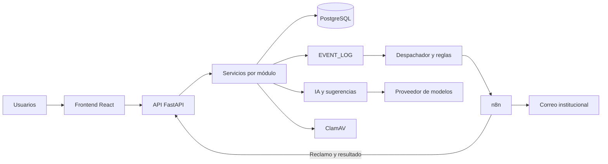

# Arquitectura, APIs y modelo de datos

Documento de entrega de la issue #72. Base: `8c361239234f94d9333e46643f1234a40e39551d`.

## Arquitectura

La aplicación separa la interfaz React/TypeScript, la API FastAPI y la persistencia PostgreSQL mediante SQLAlchemy y migraciones Alembic. Los routers reciben solicitudes y aplican dependencias de autenticación y autorización; los servicios implementan las operaciones de negocio.

El backend registra hechos en EVENT_LOG y su despachador evalúa reglas de workflows. n8n participa en el transporte de correos; no reemplaza las reglas de negocio del backend. Los envíos manuales usan reclamo y resultado autenticados para correlacionar intentos. IA/Sugerencias combina detección de patrones con un cliente de un proveedor compatible con OpenAI. ClamAV analiza adjuntos de Comunicaciones cuando la integración está habilitada.

Las capas y convenciones se detallan en [ARCHITECTURE.md](../../ARCHITECTURE.md). La configuración y operación están en [backend](../../backend/README.md), [infraestructura](../../infra/README.md) y [n8n](../../infra/n8n/README.md).

## Modelo de datos y contraste

El [diccionario](../diccionario-de-datos-esseri.md) describe el modelo conceptual y sus decisiones; [database/schema](../../database/schema/) conserva los diagramas. Para el estado implementado prevalecen los modelos SQLAlchemy y las migraciones. Este documento no modifica esas fuentes.

### Diferencias de tablas y columnas

Contraste estático de columnas declaradas con `mapped_column`, excluyendo relaciones ORM. El diccionario tiene 54 tablas y los modelos 65. No faltan tablas del diccionario en el código.

- Tabla incorporada: `archivo_justificacion_inasistencia`.
- Columnas no documentadas en `rol`: `codigo`.
- Columnas no documentadas en `permiso`: `codigo`.
- Tabla incorporada: `comunicacion`.
- Tabla incorporada: `recibo_comunicacion`.
- Tabla incorporada: `comunicacion_adjunto`.
- Tabla incorporada: `comunicacion_adjunto_contenido`.
- Columnas no documentadas en `factura`: `responsable_economico_id`.
- Tabla incorporada: `regla_facturacion`.
- Tabla incorporada: `ejecucion_facturacion`.
- Tabla incorporada: `ejecucion_facturacion_regla`.
- Tabla incorporada: `cargo_facturacion_generado`.
- Columnas no documentadas en `pago`: `usuario_registro_id`.
- Tabla incorporada: `archivo_comprobante_pago`.
- Columnas no documentadas en `movimiento`: `detalle_factura_id`.
- Columnas no documentadas en `solicitud_inscripcion`: `contacto_parentesco`.
- Columnas no documentadas en `documento_solicitud`: `contenido`, `tamanio`, `tipo_contenido`.
- Columnas del diccionario ausentes del modelo en `asistencia`: `responsable_economico_id`.
- Columnas no documentadas en `notificacion`: `envio_id`, `error_codigo`, `finished_at`, `numero_intento`, `proveedor_iniciado`, `referencia_proveedor`, `started_at`.
- Tabla incorporada: `envio_notificacion`.

El campo `responsable_economico_id` está ubicado bajo ASISTENCIA en el diccionario, pero pertenece a FACTURA en los modelos. Los tipos genéricos del diccionario (string, decimal, datetime) no expresan todas las longitudes, precisiones, índices y restricciones del esquema físico; no deben interpretarse como una especificación exhaustiva de DDL.

### Entidades por módulo

- **academico**: `nivel_educativo`, `anio`, `division`, `materia`, `docente`, `asignacion_docente`, `motivo_justificacion`, `justificacion_inasistencia`, `archivo_justificacion_inasistencia`.
- **auth**: `usuario`, `rol`, `usuario_rol`, `permiso`, `rol_permiso`, `log_acceso`.
- **comunicaciones**: `comunicacion`, `recibo_comunicacion`, `comunicacion_adjunto`, `comunicacion_adjunto_contenido`.
- **facturacion**: `factura`, `regla_facturacion`, `ejecucion_facturacion`, `ejecucion_facturacion_regla`, `cargo_facturacion_generado`, `detalle_factura`, `pago`, `archivo_comprobante_pago`, `metodo_pago`, `concepto_cobro`, `responsable_economico`, `regla_penalidad`, `excepcion_vencimiento`, `cuenta_corriente`, `movimiento`.
- **familias_alumnos**: `familia`, `alumno`, `familia_alumno`.
- **ia_sugerencias**: `ia_sugerencia`.
- **inscripciones**: `solicitud_inscripcion`, `etapa_solicitud`, `documento_solicitud`, `inscripcion`, `asistencia`.
- **Compartido**: `persona`, `audit_log`, `event_log`.
- **proveedores_compras**: `proveedor`, `producto_servicio`, `producto_proveedor`, `precio_producto`, `solicitud_compra`, `orden_compra`, `orden_compra_solicitud`, `orden_compra_detalle`, `recepcion_compra`, `recepcion_compra_detalle`.
- **workflows**: `campo_evento`, `tipo_evento`, `workflow_rule`, `notificacion_template`, `workflow_execution`, `notificacion`, `envio_notificacion`, `tarea`, `regla_destinatario`.
- **Auditoría y Panel administrativo**: consultan y agregan entidades de otros módulos, sin tablas propias.

PERSONA centraliza identidad. FAMILIA_ALUMNO vincula responsables y alumnos; INSCRIPCION conecta alumnos con la estructura académica. FACTURA, PAGO y MOVIMIENTO sostienen la cobranza. EVENT_LOG registra hechos de negocio; AUDIT_LOG registra cambios y LOG_ACCESO intentos de acceso. Comunicaciones agrega publicaciones, recibos y adjuntos; ENVIO_NOTIFICACION conserva el envío durable y NOTIFICACION sus intentos.

## Catálogo de API

Extraído estáticamente de los routers de FastAPI; no se importó la aplicación porque el Python disponible no tiene FastAPI instalado. No se inició ningún servicio. Las rutas son relativas al servidor, sin prefijo adicional. Los nombres de dependencias enlazados al código permiten consultar restricciones de alcance y pertenencia. Los permisos se evalúan sobre el rol activo de la sesión, no sobre la unión de roles.

### academico / historial_router

[Router y controles de alcance](../../backend/src/academico/historial_router.py)

| Método | Ruta | Permiso o autenticación | Descripción |
|---|---|---|---|
| GET | `/academico/asistencias/consulta` | academico.leer;  | Consultar historial |
| GET | `/academico/asistencias/filtros` | academico.leer;  | Obtener opciones historial |
| GET | `/academico/asistencias/ciclos` | academico.leer;  | Obtener ciclos historial |
| GET | `/academico/asistencias/consulta/exportar` | academico.exportar;  | Exportar historial |

### academico / router

[Router y controles de alcance](../../backend/src/academico/router.py)

| Método | Ruta | Permiso o autenticación | Descripción |
|---|---|---|---|
| POST | `/academico/niveles` | academico.crear | Crear un nuevo nivel educativo. |
| GET | `/academico/niveles` | academico.leer | Listar todos los niveles educativos. |
| GET | `/academico/niveles/{nivel_educativo_id}` | academico.leer | Obtener un nivel educativo por su ID. |
| PUT | `/academico/niveles/{nivel_educativo_id}` | academico.actualizar:estructura | Actualizar un nivel educativo existente. |
| DELETE | `/academico/niveles/{nivel_educativo_id}` | academico.eliminar | Eliminar un nivel educativo. |
| POST | `/academico/anios` | academico.crear | Crear un nuevo año. |
| GET | `/academico/anios` | academico.leer | Listar años. Opcionalmente filtrar por nivel educativo con ?nivel_educativo_id= |
| GET | `/academico/anios/{anio_id}` | academico.leer | Obtener un año por su ID. |
| PUT | `/academico/anios/{anio_id}` | academico.actualizar:estructura | Actualizar un año existente. |
| DELETE | `/academico/anios/{anio_id}` | academico.eliminar | Eliminar un año. |
| POST | `/academico/divisiones` | academico.crear | Crear una nueva división. |
| GET | `/academico/divisiones` | academico.leer | Listar divisiones. Opcionalmente filtrar por año con ?anio_id= |
| GET | `/academico/divisiones/{division_id}` | academico.leer | Obtener una división por su ID. |
| PUT | `/academico/divisiones/{division_id}` | academico.actualizar:estructura | Actualizar una división existente. |
| DELETE | `/academico/divisiones/{division_id}` | academico.eliminar | Eliminar una división. |
| POST | `/academico/materias` | academico.crear | Crear una nueva materia. |
| GET | `/academico/materias` | academico.leer | Listar materias. Opcionalmente filtrar por ?anio_id= o ?division_id= |
| GET | `/academico/materias/{materia_id}` | academico.leer | Obtener una materia por su ID. |
| PUT | `/academico/materias/{materia_id}` | academico.actualizar:estructura | Actualizar una materia existente. |
| DELETE | `/academico/materias/{materia_id}` | academico.eliminar | Eliminar una materia. |
| POST | `/academico/docentes` | academico.crear | Crear un nuevo docente. |
| GET | `/academico/docentes` | academico.leer | Listar todos los docentes. |
| POST | `/academico/docentes/alta-completa` | academico.crear | Crear Persona + Usuario (rol docente) + Docente en un único alta. Antes de |
| POST | `/academico/docentes/desde-usuario` | academico.crear | Suma el rol docente (y su ficha) a una cuenta que ya existe, ej. desde el diálogo de |
| GET | `/academico/docentes/me/divisiones` | Sesión; alcance definido por dependencias | Divisiones asignadas al docente autenticado. Dato propio: solo requiere sesión, no |
| GET | `/academico/docentes/me/perfil` | Sesión; alcance definido por dependencias | Devolver el nombre real del perfil docente de la propia cuenta autenticada. |
| GET | `/academico/docentes/me/divisiones/{division_id}/alumnos` | Sesión; alcance definido por dependencias | Roster activo de una división del ciclo asignado al usuario autenticado. |
| GET | `/academico/docentes/me/divisiones/{division_id}/seguimiento` | Sesión; alcance definido por dependencias | Indicadores de inasistencia calculados con registros reales del ciclo. |
| GET | `/academico/docentes/{docente_id}` | academico.leer | Obtener un docente por su ID. |
| PUT | `/academico/docentes/{docente_id}` | academico.actualizar:estructura | Actualizar un docente existente. |
| DELETE | `/academico/docentes/{docente_id}` | academico.eliminar | Eliminar un docente. |
| POST | `/academico/asignaciones-docentes` | academico.crear | Asignar un docente a materia+división por ciclo lectivo. |
| GET | `/academico/asignaciones-docentes` | academico.leer | Listar asignaciones docentes con filtros opcionales. |
| GET | `/academico/asignaciones-docentes/{asignacion_id}` | academico.leer | Obtener una asignación docente por su ID. |
| DELETE | `/academico/asignaciones-docentes/{asignacion_id}` | academico.eliminar | Desasignar un docente (eliminar la asignación docente). |
| POST | `/academico/asistencias` | academico.actualizar:asistencia | Registrar asistencia diaria de un alumno. |
| POST | `/academico/asistencias/bulk` | academico.actualizar:asistencia | Registrar asistencia de toda una división en una fecha. |
| GET | `/academico/asistencias` | academico.leer | Listar registros de asistencia con filtros opcionales. |
| GET | `/academico/familia/alumnos/{alumno_id}/asistencias` | Sesión; alcance definido por dependencias | Historial diario del alumno, limitado a la familia autenticada. |
| POST | `/academico/familia/asistencias/{asistencia_id}/justificaciones` | Sesión; alcance definido por dependencias | Justificar asistencia familia |
| GET | `/academico/justificaciones` | academico.actualizar:justificaciones | Listar justificaciones endpoint |
| PATCH | `/academico/justificaciones/{justificacion_id}/resolver` | academico.actualizar:justificaciones | Resolver justificacion endpoint |
| GET | `/academico/justificaciones/{justificacion_id}/archivo` | academico.actualizar:justificaciones | Descargar archivo justificacion |
| GET | `/academico/familia/justificaciones/{justificacion_id}/archivo` | Sesión; alcance definido por dependencias | Descarga un comprobante únicamente si pertenece a un alumno vinculado. |
| GET | `/academico/asistencias/resumen` | academico.leer | Calcular resumen de asistencia de un alumno en un período (RF-06). |
| GET | `/academico/asistencias/exportar` | academico.exportar | Exportación del historial de asistencias (RF-37): reporte institucional en el período |
| GET | `/academico/asistencias/{asistencia_id}` | academico.leer | Obtener un registro de asistencia por su ID. |
| PUT | `/academico/asistencias/{asistencia_id}` | academico.actualizar:asistencia | Actualizar un registro de asistencia. |
| DELETE | `/academico/asistencias/{asistencia_id}` | academico.eliminar | Eliminar un registro de asistencia. |

### auditoria / router

[Router y controles de alcance](../../backend/src/auditoria/router.py)

| Método | Ruta | Permiso o autenticación | Descripción |
|---|---|---|---|
| GET | `/auditoria/{entidad}/{entidad_id}` | auditoria.leer;  | Historial de cambios de campo de una entidad, ordenado cronológicamente. |

### auth / router

[Router y controles de alcance](../../backend/src/auth/router.py)

| Método | Ruta | Permiso o autenticación | Descripción |
|---|---|---|---|
| GET | `/auth/google/login` | Público; validaciones del flujo de autenticación | Manda el navegador a Google. El frontend solo necesita linkear acá. |
| GET | `/auth/google/callback` | Público; validaciones del flujo de autenticación | Google callback |
| POST | `/auth/login` | Público; validaciones del flujo de autenticación | Fallback con contraseña, para cuando Google no está disponible. |
| GET | `/auth/me` | Sesión; alcance definido por dependencias | Me |
| POST | `/auth/rol-activo` | Sesión; alcance definido por dependencias | Establecer rol activo |
| POST | `/auth/logout` | Público; validaciones del flujo de autenticación | Logout |
| GET | `/auth/roles` | autenticacion.leer | Listar roles |
| POST | `/auth/roles` | autenticacion.crear | Crear rol |
| GET | `/auth/roles/{rol_id}` | autenticacion.leer; obtener_rol_o_404 | Obtener rol |
| PUT | `/auth/roles/{rol_id}` | autenticacion.actualizar; obtener_rol_o_404 | Actualizar rol |
| DELETE | `/auth/roles/{rol_id}` | autenticacion.eliminar; obtener_rol_o_404 | Eliminar rol |
| GET | `/auth/permisos` | autenticacion.leer | Listar permisos |
| POST | `/auth/permisos` | autenticacion.crear | Crear permiso |
| GET | `/auth/permisos/{permiso_id}` | autenticacion.leer; obtener_permiso_o_404 | Obtener permiso |
| PUT | `/auth/permisos/{permiso_id}` | autenticacion.actualizar; obtener_permiso_o_404 | Actualizar permiso |
| DELETE | `/auth/permisos/{permiso_id}` | autenticacion.eliminar; obtener_permiso_o_404 | Eliminar permiso |
| GET | `/auth/roles/{rol_id}/permisos` | autenticacion.leer; obtener_rol_o_404 | Listar permisos de rol |
| POST | `/auth/roles/{rol_id}/permisos` | autenticacion.actualizar; obtener_rol_o_404 | Asignar permiso a rol |
| DELETE | `/auth/roles/{rol_id}/permisos/{permiso_id}` | autenticacion.actualizar; obtener_rol_o_404, obtener_permiso_o_404 | Quitar permiso a rol |
| GET | `/auth/usuarios` | autenticacion.leer | Listar usuarios |
| POST | `/auth/usuarios` | autenticacion.crear | Alta de una cuenta de personal. Familia y docente tienen su propio formulario (crean, |
| GET | `/auth/usuarios/{usuario_id}` | autenticacion.leer; obtener_usuario_o_404 | Obtener usuario |
| PATCH | `/auth/usuarios/{usuario_id}` | autenticacion.actualizar; obtener_usuario_o_404 | Actualizar usuario |
| PUT | `/auth/usuarios/{usuario_id}/acceso` | autenticacion.actualizar; obtener_usuario_o_404 | Actualizar acceso usuario |
| PUT | `/auth/usuarios/{usuario_id}/estado` | autenticacion.eliminar; obtener_usuario_o_404 | Baja lógica (`inactivo`) o reactivación (`activo`). Va detrás del permiso de eliminar: |
| DELETE | `/auth/usuarios/{usuario_id}` | autenticacion.eliminar; obtener_usuario_o_404 | Borrado físico, irreversible. Rechaza cuentas con historial (usar la baja lógica en ese |
| GET | `/auth/usuarios/{usuario_id}/roles` | autenticacion.leer; obtener_usuario_o_404 | Listar roles de usuario |
| POST | `/auth/usuarios/{usuario_id}/roles` | autenticacion.actualizar; obtener_usuario_o_404 | Asignar rol a usuario |
| DELETE | `/auth/usuarios/{usuario_id}/roles/{rol_id}` | autenticacion.actualizar; obtener_usuario_o_404, obtener_rol_o_404 | Quitar rol a usuario |

### comunicaciones / adjuntos_router

[Router y controles de alcance](../../backend/src/comunicaciones/adjuntos_router.py)

| Método | Ruta | Permiso o autenticación | Descripción |
|---|---|---|---|
| GET | `/comunicaciones/familia/{comunicacion_id}/adjuntos/{adjunto_id}/archivo` | comunicaciones.leer | Descargar familia |
| POST | `/comunicaciones/docente/{comunicacion_id}/adjuntos` | comunicaciones.crear:docente | Subir docente |
| GET | `/comunicaciones/docente/{comunicacion_id}/adjuntos` | comunicaciones.leer:docente | Listar docente |
| GET | `/comunicaciones/docente/{comunicacion_id}/adjuntos/{adjunto_id}/archivo` | comunicaciones.leer:docente | Descargar docente |
| POST | `/comunicaciones/docente/{comunicacion_id}/adjuntos/{adjunto_id}/analizar` | comunicaciones.actualizar:docente | Analizar docente |
| DELETE | `/comunicaciones/docente/{comunicacion_id}/adjuntos/{adjunto_id}` | comunicaciones.actualizar:docente | Eliminar docente |
| POST | `/comunicaciones/{comunicacion_id}/adjuntos` | comunicaciones.crear | Subir |
| GET | `/comunicaciones/{comunicacion_id}/adjuntos` | comunicaciones.leer | Listar |
| GET | `/comunicaciones/{comunicacion_id}/adjuntos/{adjunto_id}/archivo` | comunicaciones.leer | Descargar |
| POST | `/comunicaciones/{comunicacion_id}/adjuntos/{adjunto_id}/analizar` | comunicaciones.actualizar | Analizar |
| DELETE | `/comunicaciones/{comunicacion_id}/adjuntos/{adjunto_id}` | comunicaciones.actualizar | Eliminar |

### comunicaciones / router

[Router y controles de alcance](../../backend/src/comunicaciones/router.py)

| Método | Ruta | Permiso o autenticación | Descripción |
|---|---|---|---|
| GET | `/comunicaciones/familia` | comunicaciones.leer | Bandeja |
| GET | `/comunicaciones/familia/{id}` | comunicaciones.leer | Detalle |
| PUT | `/comunicaciones/familia/{id}/lectura` | comunicaciones.leer | Lectura |
| GET | `/comunicaciones/docente/opciones` | comunicaciones.leer:docente | Opciones docente |
| POST | `/comunicaciones/docente/vista-previa` | comunicaciones.crear:docente | Vista previa docente |
| GET | `/comunicaciones/docente` | comunicaciones.leer:docente | Listado docente |
| POST | `/comunicaciones/docente` | comunicaciones.crear:docente | Crear docente |
| GET | `/comunicaciones/docente/{id}` | comunicaciones.leer:docente | Obtener docente |
| PUT | `/comunicaciones/docente/{id}` | comunicaciones.actualizar:docente | Editar docente |
| POST | `/comunicaciones/docente/{id}/publicar` | comunicaciones.crear:docente | Publicar docente |
| GET | `/comunicaciones/opciones` | comunicaciones.crear | Opciones |
| POST | `/comunicaciones/vista-previa` | comunicaciones.crear | Vista previa |
| GET | `/comunicaciones` | comunicaciones.leer | Listado |
| POST | `/comunicaciones` | comunicaciones.crear | Crear |
| GET | `/comunicaciones/{id}` | comunicaciones.leer | Obtener |
| PUT | `/comunicaciones/{id}` | comunicaciones.actualizar | Editar |
| POST | `/comunicaciones/{id}/publicar` | comunicaciones.crear | Publicar |
| GET | `/comunicaciones/docente/{id}/envios` | comunicaciones.leer:docente | Envios docente |
| GET | `/comunicaciones/docente/{id}/destinatarios` | comunicaciones.leer:docente | Destinatarios docente |
| GET | `/comunicaciones/{id}/destinatarios` | comunicaciones.leer | Destinatarios |
| GET | `/comunicaciones/{id}/envios` | comunicaciones.leer | Envios |
| POST | `/comunicaciones/docente/{id}/envios/{envio_id}/reintentar` | comunicaciones.crear:docente | Reintento docente |
| POST | `/comunicaciones/{id}/envios/{envio_id}/reintentar` | comunicaciones.crear | Reintento |

### facturacion / router

[Router y controles de alcance](../../backend/src/facturacion/router.py)

| Método | Ruta | Permiso o autenticación | Descripción |
|---|---|---|---|
| GET | `/facturacion/familia/me` | Sesión; alcance definido por dependencias;  | Obtener facturacion de mi familia |
| GET | `/facturacion/familia/me/pagos/{pago_id}/comprobante` | Sesión; alcance definido por dependencias;  | Descargar comprobante pago familia |
| POST | `/facturacion/conceptos` | facturacion.crear;  | Crear concepto cobro |
| GET | `/facturacion/conceptos` | facturacion.leer;  | Listar conceptos cobro |
| GET | `/facturacion/conceptos/{concepto_id}` | facturacion.leer; obtener_concepto_cobro_o_404 | Obtener concepto cobro |
| PUT | `/facturacion/conceptos/{concepto_id}` | facturacion.actualizar; obtener_concepto_cobro_o_404 | Actualizar concepto cobro |
| DELETE | `/facturacion/conceptos/{concepto_id}` | facturacion.eliminar; obtener_concepto_cobro_o_404 | Eliminar concepto cobro |
| POST | `/facturacion/alumnos/{alumno_id}/responsable-economico` | facturacion.actualizar; obtener_alumno_o_404 | Asignar responsable economico |
| GET | `/facturacion/alumnos/{alumno_id}/responsable-economico` | facturacion.leer; obtener_alumno_o_404 | Obtener responsable economico actual |
| GET | `/facturacion/alumnos/{alumno_id}/responsable-economico/historial` | facturacion.leer; obtener_alumno_o_404 | Listar historial responsables economicos |
| GET | `/facturacion/alumnos/{alumno_id}/cuenta-corriente` | facturacion.leer; obtener_alumno_o_404 | Obtener cuenta corriente |
| GET | `/facturacion/deudas/familias` | facturacion.leer;  | Listar deuda por familia |
| POST | `/facturacion/facturas` | facturacion.crear;  | Crear factura |
| GET | `/facturacion/facturas` | facturacion.leer;  | Listar facturas |
| GET | `/facturacion/metodos-pago` | facturacion.leer;  | Listar metodos pago |
| GET | `/facturacion/facturas/{factura_id}/pdf` | facturacion.leer; obtener_factura_o_404 | Descargar factura pdf |
| POST | `/facturacion/facturas/{factura_id}/pagos` | facturacion.crear; obtener_factura_o_404 | Registrar pago |
| GET | `/facturacion/pagos/{pago_id}/comprobante` | facturacion.leer; obtener_pago_accesible_o_404 | Descargar comprobante pago |
| GET | `/facturacion/facturas/{factura_id}` | facturacion.leer; obtener_factura_o_404 | Obtener factura |
| PUT | `/facturacion/facturas/{factura_id}` | facturacion.actualizar; obtener_factura_o_404 | Actualizar factura |
| DELETE | `/facturacion/facturas/{factura_id}` | facturacion.eliminar; obtener_factura_o_404 | Eliminar factura |
| POST | `/facturacion/reglas` | facturacion.crear;  | Crear regla facturacion |
| GET | `/facturacion/reglas` | facturacion.leer;  | Listar reglas facturacion |
| POST | `/facturacion/reglas/generaciones/previsualizar` | facturacion.leer;  | Previsualizar generacion facturacion |
| POST | `/facturacion/reglas/generaciones` | facturacion.crear;  | Generar facturacion |
| GET | `/facturacion/reglas/generaciones` | facturacion.leer;  | Listar ejecuciones facturacion |
| GET | `/facturacion/reglas/{regla_id}` | facturacion.leer;  | Obtener regla facturacion |
| PUT | `/facturacion/reglas/{regla_id}` | facturacion.actualizar;  | Actualizar regla facturacion |
| PATCH | `/facturacion/reglas/{regla_id}/estado` | facturacion.actualizar;  | Actualizar estado regla facturacion |
| POST | `/facturacion/vencimientos/procesar` | facturacion.actualizar;  | Corre la detección de facturas vencidas sin esperar al job (útil para probar). |
| GET | `/facturacion/penalidades` | facturacion.leer;  | Listar reglas penalidad |
| POST | `/facturacion/penalidades` | facturacion.crear;  | Crear regla penalidad |
| PUT | `/facturacion/penalidades/{regla_id}` | facturacion.actualizar;  | Actualizar regla penalidad |
| PATCH | `/facturacion/penalidades/{regla_id}/estado` | facturacion.actualizar;  | Actualizar estado regla penalidad |
| GET | `/facturacion/familias/{familia_id}/excepciones-vencimiento` | facturacion.leer; obtener_familia_o_404 | Listar excepciones vencimiento |
| POST | `/facturacion/familias/{familia_id}/excepciones-vencimiento` | facturacion.crear; obtener_familia_o_404 | Crear excepcion vencimiento |
| POST | `/facturacion/excepciones-vencimiento/{excepcion_id}/anular` | facturacion.actualizar;  | Anular excepcion vencimiento |

### familias_alumnos / router

[Router y controles de alcance](../../backend/src/familias_alumnos/router.py)

| Método | Ruta | Permiso o autenticación | Descripción |
|---|---|---|---|
| POST | `/familias-alumnos/alta-completa` | familias_alumnos.crear | Crear Persona responsable, Usuario con rol familia y Familia. |
| POST | `/familias-alumnos/familias` | familias_alumnos.crear | Crear una nueva Familia. |
| GET | `/familias-alumnos/familias` | familias_alumnos.leer | Listar familias con filtros opcionales. El rol familia solo ve la propia. |
| GET | `/familias-alumnos/familias/me/alumnos` | Sesión; alcance definido por dependencias | Alumnos a cargo del usuario autenticado. Dato propio: solo requiere sesión, no |
| GET | `/familias-alumnos/familias/{familia_id}` | familias_alumnos.leer | Obtener una familia por su ID. |
| PUT | `/familias-alumnos/familias/{familia_id}` | familias_alumnos.actualizar | Actualizar una familia existente. |
| DELETE | `/familias-alumnos/familias/{familia_id}` | familias_alumnos.eliminar | Eliminar una familia (baja física). |
| POST | `/familias-alumnos/alumnos/alta-completa` | familias_alumnos.crear | Crear Persona y Alumno en una única transacción. |
| POST | `/familias-alumnos/alumnos` | familias_alumnos.crear | Crear un nuevo Alumno. |
| GET | `/familias-alumnos/alumnos` | familias_alumnos.leer | Listar alumnos con filtros opcionales. El rol familia solo ve los vinculados. |
| GET | `/familias-alumnos/alumnos/{alumno_id}` | familias_alumnos.leer | Obtener un alumno por su ID. |
| PUT | `/familias-alumnos/alumnos/{alumno_id}` | familias_alumnos.actualizar | Actualizar un alumno existente. |
| DELETE | `/familias-alumnos/alumnos/{alumno_id}` | familias_alumnos.eliminar | Eliminar un alumno (baja física). |
| POST | `/familias-alumnos/vinculos` | familias_alumnos.crear | Vincular un alumno con una familia. |
| GET | `/familias-alumnos/vinculos/{vinculo_id}` | familias_alumnos.leer | Obtener un vínculo familia-alumno por su ID. |
| PUT | `/familias-alumnos/vinculos/{vinculo_id}` | familias_alumnos.actualizar | Actualizar un vínculo existente (parentesco, responsable_principal, etc.). |
| DELETE | `/familias-alumnos/vinculos/{vinculo_id}` | familias_alumnos.eliminar | Desvincular un alumno de una familia. |
| GET | `/familias-alumnos/alumnos/{alumno_id}/vinculos` | familias_alumnos.leer | Listar las familias vinculadas a un alumno. El rol familia solo ve su vínculo. |
| GET | `/familias-alumnos/familias/{familia_id}/vinculos` | familias_alumnos.leer | Listar todos los alumnos vinculados a una familia. |

### ia_sugerencias / router

[Router y controles de alcance](../../backend/src/ia_sugerencias/router.py)

| Método | Ruta | Permiso o autenticación | Descripción |
|---|---|---|---|
| GET | `/ia-sugerencias/sugerencias` | PERMISO_IA_SUGERENCIAS_LEER | Listar sugerencias, de la más reciente a la más vieja. |
| GET | `/ia-sugerencias/sugerencias/{sugerencia_id}` | PERMISO_IA_SUGERENCIAS_LEER | Obtener una sugerencia por su ID. |
| POST | `/ia-sugerencias/sugerencias/{sugerencia_id}/aprobar` | PERMISO_IA_SUGERENCIAS_ACTUALIZAR | Aprobar una sugerencia pendiente. Da 409 si ya fue revisada. |
| POST | `/ia-sugerencias/sugerencias/{sugerencia_id}/rechazar` | PERMISO_IA_SUGERENCIAS_ACTUALIZAR | Rechazar una sugerencia pendiente. Da 409 si ya fue revisada. |
| POST | `/ia-sugerencias/patrones/detectar` | PERMISO_IA_SUGERENCIAS_CREAR | Buscar patrones de morosidad e inasistencias y dejarlos como sugerencias pendientes. |
| POST | `/ia-sugerencias/comunicaciones` | PERMISO_IA_SUGERENCIAS_CREAR | Pedir un borrador de comunicación para un evento y dejarlo pendiente de revisión. |

### inscripciones / router

[Router y controles de alcance](../../backend/src/inscripciones/router.py)

| Método | Ruta | Permiso o autenticación | Descripción |
|---|---|---|---|
| GET | `/inscripciones` | inscripciones.leer;  | Listar inscripciones |
| GET | `/inscripciones/exportar` | inscripciones.exportar;  | Descargar en CSV todas las inscripciones que coinciden con los filtros del listado. |
| GET | `/inscripciones/resumen` | inscripciones.leer;  | Obtener resumen inscripciones |
| POST | `/inscripciones` | inscripciones.crear;  | Crear inscripcion |
| POST | `/inscripciones/reinscripciones` | inscripciones.crear;  | Crear reinscripcion |
| POST | `/inscripciones/solicitudes` | inscripciones.crear;  | Crear solicitud inscripcion |
| GET | `/inscripciones/solicitudes` | inscripciones.leer;  | Listar solicitudes inscripcion |
| GET | `/inscripciones/solicitudes/{solicitud_id}` | inscripciones.leer;  | Obtener solicitud inscripcion |
| PUT | `/inscripciones/solicitudes/{solicitud_id}` | inscripciones.actualizar;  | Editar los datos administrativos de una admisión que sigue en proceso. |
| POST | `/inscripciones/solicitudes/{solicitud_id}/avanzar` | inscripciones.actualizar;  | Avanzar solicitud inscripcion |
| POST | `/inscripciones/solicitudes/{solicitud_id}/revertir-etapa` | inscripciones.actualizar;  | Revertir ultima etapa solicitud |
| POST | `/inscripciones/solicitudes/{solicitud_id}/desistir` | inscripciones.actualizar;  | Desistir solicitud inscripcion |
| POST | `/inscripciones/solicitudes/{solicitud_id}/aprobar` | inscripciones.actualizar;  | Aprobar solicitud inscripcion |
| POST | `/inscripciones/solicitudes/{solicitud_id}/confirmar-inscripcion` | inscripciones.actualizar;  | Confirma una admisión documentada; no crea todavía la inscripción académica. |
| POST | `/inscripciones/solicitudes/{solicitud_id}/alta-integrada` | inscripciones.actualizar;  | Crea o reutiliza los datos académicos y familiares desde una admisión documentada. |
| POST | `/inscripciones/solicitudes/{solicitud_id}/revocar-aprobacion` | inscripciones.actualizar;  | Revocar aprobacion solicitud |
| POST | `/inscripciones/solicitudes/{solicitud_id}/rechazar` | inscripciones.actualizar;  | Rechazar solicitud inscripcion |
| POST | `/inscripciones/solicitudes/{solicitud_id}/documentos` | inscripciones.actualizar;  | Registrar documento solicitud |
| GET | `/inscripciones/solicitudes/{solicitud_id}/documentos/{documento_id}/archivo` | inscripciones.leer;  | Obtener archivo documento solicitud |
| PUT | `/inscripciones/solicitudes/{solicitud_id}/documentos/{documento_id}` | inscripciones.actualizar;  | Actualizar documento solicitud |
| POST | `/inscripciones/{inscripcion_id}/cambios-matricula` | inscripciones.actualizar;  | Registrar cambio matricula |
| POST | `/inscripciones/{inscripcion_id}/bajas` | inscripciones.actualizar;  | Registrar baja inscripcion |
| GET | `/inscripciones/opciones/solicitudes` | inscripciones.leer;  | Listar solicitudes disponibles |
| GET | `/inscripciones/opciones/divisiones` | inscripciones.leer;  | Listar divisiones disponibles |
| GET | `/inscripciones/opciones/reinscripciones` | inscripciones.leer;  | Listar alumnos elegibles reinscripcion |
| GET | `/inscripciones/{inscripcion_id}` | inscripciones.leer;  | Obtener inscripcion |

### panel_admin / router

[Router y controles de alcance](../../backend/src/panel_admin/router.py)

| Método | Ruta | Permiso o autenticación | Descripción |
|---|---|---|---|
| GET | `/panel-admin/indicadores-direccion` | panel_administrativo.leer;  | Obtener indicadores |
| GET | `/panel-admin/evolucion-financiera` | facturacion.leer, panel_administrativo.leer;  | Obtener evolucion |
| GET | `/panel-admin/actividad-reciente` | panel_administrativo.leer;  | Hechos recientes de las categorías que el rol activo puede ver. |

### proveedores_compras / router

[Router y controles de alcance](../../backend/src/proveedores_compras/router.py)

| Método | Ruta | Permiso o autenticación | Descripción |
|---|---|---|---|
| POST | `/proveedores-compras/proveedores` | proveedores_compras.crear | Dar de alta un proveedor (RF-19). |
| GET | `/proveedores-compras/proveedores` | proveedores_compras.leer | Listar los proveedores, ordenados por nombre. |
| GET | `/proveedores-compras/proveedores/{proveedor_id}` | proveedores_compras.leer | Obtener un proveedor por su ID. |
| PUT | `/proveedores-compras/proveedores/{proveedor_id}` | proveedores_compras.actualizar | Modificar un proveedor existente (RF-19). |
| DELETE | `/proveedores-compras/proveedores/{proveedor_id}` | proveedores_compras.eliminar | Eliminar un proveedor (baja física). |
| POST | `/proveedores-compras/solicitudes` | proveedores_compras.crear | Registrar una solicitud interna de compra (RF-20). |
| GET | `/proveedores-compras/solicitudes` | proveedores_compras.leer | Listar las solicitudes, de la más reciente a la más vieja. |
| GET | `/proveedores-compras/solicitudes/{solicitud_id}` | proveedores_compras.leer | Obtener una solicitud por su ID. |
| PUT | `/proveedores-compras/solicitudes/{solicitud_id}` | proveedores_compras.actualizar | Corregir los datos de una solicitud. Para aprobar o rechazar, ver el endpoint de estado. |
| PATCH | `/proveedores-compras/solicitudes/{solicitud_id}/estado` | proveedores_compras.actualizar | Aprobar o rechazar una solicitud (RF-20). |
| DELETE | `/proveedores-compras/solicitudes/{solicitud_id}` | proveedores_compras.eliminar | Eliminar una solicitud. |
| POST | `/proveedores-compras/productos` | proveedores_compras.crear | Dar de alta un ítem en el catálogo de compras. |
| GET | `/proveedores-compras/productos` | proveedores_compras.leer | Listar el catálogo completo, activos e inactivos, ordenado por nombre. |
| GET | `/proveedores-compras/productos/{producto_id}` | proveedores_compras.leer | Obtener un ítem del catálogo por su ID. |
| PUT | `/proveedores-compras/productos/{producto_id}` | proveedores_compras.actualizar | Modificar un ítem del catálogo. Para darlo de baja, alcanza con `activo = false`. |
| DELETE | `/proveedores-compras/productos/{producto_id}` | proveedores_compras.eliminar | Eliminar un ítem del catálogo que todavía no se usó. |
| GET | `/proveedores-compras/productos/{producto_id}/proveedores` | proveedores_compras.leer | Proveedores que ofrecen el ítem, cada uno con su precio vigente hoy (issue #114). |
| POST | `/proveedores-compras/productos/{producto_id}/proveedores` | proveedores_compras.crear | Registrar que un proveedor ofrece el ítem. Da 409 si ya estaba asociado. |
| DELETE | `/proveedores-compras/productos/{producto_id}/proveedores/{proveedor_id}` | proveedores_compras.eliminar | Quitar un proveedor del ítem. Da 409 si ya tiene precios cargados para ese ítem. |
| GET | `/proveedores-compras/productos/{producto_id}/precios` | proveedores_compras.leer | Histórico de precios del ítem, del más reciente al más viejo. |
| POST | `/proveedores-compras/productos/{producto_id}/precios` | proveedores_compras.crear | Cargar un precio nuevo para uno de los proveedores del ítem. |
| PUT | `/proveedores-compras/precios/{precio_id}` | proveedores_compras.actualizar | Corregir un precio mal cargado. Un aumento no va acá: es un precio nuevo. |
| POST | `/proveedores-compras/ordenes` | proveedores_compras.crear | Emitir una orden de compra a partir de solicitudes aprobadas (RF-21). |
| GET | `/proveedores-compras/ordenes` | proveedores_compras.leer | Listar las órdenes, de la más reciente a la más vieja, con su detalle. |
| GET | `/proveedores-compras/ordenes/{orden_id}` | proveedores_compras.leer | Obtener una orden con su detalle y las solicitudes que la originaron. |
| PATCH | `/proveedores-compras/ordenes/{orden_id}/estado` | proveedores_compras.actualizar | Cancelar una orden emitida. |
| GET | `/proveedores-compras/ordenes/{orden_id}/pendientes` | proveedores_compras.leer | Cuánto se pidió, cuánto llegó y cuánto falta por línea. |
| POST | `/proveedores-compras/ordenes/{orden_id}/recepciones` | proveedores_compras.crear | Registrar una recepción, total o parcial, contra una orden emitida. |
| GET | `/proveedores-compras/ordenes/{orden_id}/recepciones` | proveedores_compras.leer | Historial de recepciones de una orden. |
| GET | `/proveedores-compras/ordenes-buscar` | proveedores_compras.leer | Buscar órdenes por proveedor y estado, paginado (RF-34/RF-35). |
| GET | `/proveedores-compras/proveedores-exportar` | proveedores_compras.exportar | Descargar el listado de proveedores en CSV (RF-38). |
| GET | `/proveedores-compras/ordenes-exportar` | proveedores_compras.exportar | Descargar el listado de órdenes de compra en CSV (RF-38). |

### workflows / manuales_router

[Router y controles de alcance](../../backend/src/workflows/manuales_router.py)

| Método | Ruta | Permiso o autenticación | Descripción |
|---|---|---|---|
| POST | `/workflows/envios/{envio_id}/reclamar` | Token N8N_WEBHOOK_TOKEN; exigir_token_n8n | Reclamar envio |
| POST | `/workflows/envios/{envio_id}/resultado` | Token N8N_WEBHOOK_TOKEN; exigir_token_n8n | Registrar resultado envio |

### workflows / router

[Router y controles de alcance](../../backend/src/workflows/router.py)

| Método | Ruta | Permiso o autenticación | Descripción |
|---|---|---|---|
| GET | `/workflows/tipos-evento` | workflows.leer;  | Listar tipos evento |
| GET | `/workflows/tipos-accion` | workflows.leer | Listar tipos accion |
| GET | `/workflows/plantillas` | workflows.leer;  | Listar plantillas |
| POST | `/workflows/plantillas` | workflows.crear;  | Crear plantilla |
| GET | `/workflows/plantillas/{plantilla_id}` | workflows.leer; obtener_plantilla_o_404 | Obtener plantilla |
| PATCH | `/workflows/plantillas/{plantilla_id}` | workflows.actualizar; obtener_plantilla_o_404 | Actualizar plantilla |
| DELETE | `/workflows/plantillas/{plantilla_id}` | workflows.eliminar; obtener_plantilla_o_404 | Eliminar plantilla |
| GET | `/workflows/ejecuciones` | workflows.leer;  | Listar ejecuciones |
| GET | `/workflows/ejecuciones/{ejecucion_id}` | workflows.leer;  | Obtener ejecucion |
| POST | `/workflows/ejecuciones/{ejecucion_id}/reintentar` | workflows.actualizar;  | Reintentar ejecucion |
| POST | `/workflows/ejecuciones/{ejecucion_id}/aprobar` | workflows.actualizar;  | Aprobar ejecucion |
| POST | `/workflows/ejecuciones/{ejecucion_id}/rechazar` | workflows.actualizar;  | Rechazar ejecucion |
| GET | `/workflows/notificaciones` | workflows.leer;  | Listar notificaciones |
| GET | `/workflows/notificaciones/{notificacion_id}` | workflows.leer;  | Obtener notificacion |
| GET | `/workflows/tareas` | Sesión; alcance definido por dependencias; obtener_alcance_tareas | Sin `workflows.leer` solo devuelve las tareas del usuario, aunque no pida `solo_mias` ni |
| GET | `/workflows/tareas/{tarea_id}` | Sesión; alcance definido por dependencias; obtener_alcance_tareas | Obtener tarea |
| PATCH | `/workflows/tareas/{tarea_id}/estado` | Sesión; alcance definido por dependencias; obtener_alcance_tareas | La avanza su responsable o quien tenga `workflows.actualizar`. |
| PATCH | `/workflows/tareas/{tarea_id}/asignado` | workflows.actualizar;  | Solo con `workflows.actualizar`: reasignar es una decisión de gestión, no de quien |
| GET | `/workflows/reglas` | workflows.leer;  | Listar reglas |
| GET | `/workflows/reglas/{regla_id}` | workflows.leer; obtener_regla_o_404 | Obtener regla |
| POST | `/workflows/reglas` | workflows.crear;  | Crear regla |
| PATCH | `/workflows/reglas/{regla_id}` | workflows.actualizar; obtener_regla_o_404 | Actualizar regla |
| GET | `/workflows/reglas/{regla_id}/destinatarios` | workflows.leer; obtener_regla_o_404 | Listar destinatarios regla |
| PUT | `/workflows/reglas/{regla_id}/destinatarios` | workflows.actualizar; obtener_regla_o_404 | Reemplazar destinatarios regla |
| POST | `/workflows/procesar` | workflows.actualizar;  | Corre una pasada del despachador sin esperar al job periódico (útil para probar). Incluye |

### Salud

`GET /health`: público, devuelve el estado del proceso; no verifica conectividad de base de datos.

## Eventos y acciones de workflows

El catálogo cerrado está en [constants.py](../../backend/src/workflows/constants.py), con su precarga en [grupo-a.yaml](../../database/seeds/grupo-a.yaml). EVENT_LOG asocia tipo, entidad, identificador y payload; el catálogo no implica que cada evento se produzca en todas las instalaciones.

| Evento | Entidad |
|---|---|
| `inasistencia.registrada` | `asistencia` |
| `inasistencia.justificada` | `justificacion_inasistencia` |
| `factura.vencida` | `factura` |
| `inscripcion.cambio_matricula` | `inscripcion` |
| `solicitud_inscripcion.aprobada` | `solicitud_inscripcion` |
| `pago.registrado` | `pago` |
| `pago.rechazado` | `pago` |
| `orden_compra.emitida` | `orden_compra` |
| `recepcion_compra.registrada` | `recepcion_compra` |
| `inscripcion.confirmada` | `inscripcion` |
| `solicitud_compra.aprobada` | `solicitud_compra` |

Los 15 tipos de acción admitidos por las reglas:

| Acción | Propósito | Eventos admitidos | Aprobación por defecto |
|---|---|---|---|
| `notificar` | Notificar | Cualquiera | No |
| `alerta_interna` | Alerta interna | Cualquiera | No |
| `cambiar_estado` | Cambiar estado | factura.vencida | No |
| `crear_tarea` | Crear tarea | Cualquiera | No |
| `generar_cargo` | Generar cargo | inscripcion.confirmada, pago.rechazado | Sí |
| `aplicar_vencimiento` | Aplicar vencimiento | factura.vencida | No |
| `aplicar_penalidad` | Aplicar penalidad | factura.vencida | Sí |
| `registrar_pago` | Registrar pago | pago.registrado | Sí |
| `registrar_rechazo` | Registrar rechazo | pago.rechazado | Sí |
| `actualizar_cuenta_corriente` | Actualizar cuenta corriente | factura.vencida, pago.rechazado, pago.registrado | No |
| `generar_recordatorio` | Generar recordatorio | Cualquiera | No |
| `escalar_caso` | Escalar caso | Cualquiera | Sí |
| `crear_registro_relacionado` | Crear registro relacionado | solicitud_inscripcion.aprobada | No |
| `generar_orden_compra` | Generar orden compra | solicitud_compra.aprobada | Sí |
| `generar_comunicacion` | Generar comunicacion | Cualquiera | No |

`generar_recordatorio` es diferida: el despachador la procesa al cumplirse el plazo configurado. La aprobación indicada es el valor por defecto de la acción; la regla persiste su propia configuración. Consultar los ejecutores y validaciones en [workflows](../../backend/src/workflows/) para parámetros y efectos de cada acción.
