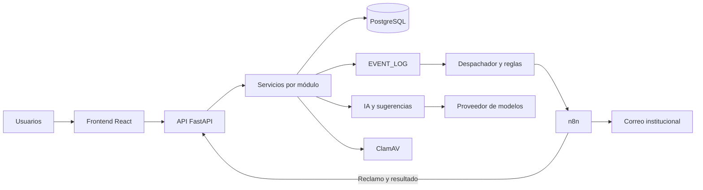

# Arquitectura, APIs y modelo de datos

Documento de entrega de la issue #72. Base: `8c361239234f94d9333e46643f1234a40e39551d`.

## Arquitectura

La aplicación separa la interfaz React/TypeScript, la API FastAPI y la persistencia PostgreSQL mediante SQLAlchemy y migraciones Alembic. Los routers reciben solicitudes y aplican dependencias de autenticación y autorización; los servicios implementan las operaciones de negocio.

El backend registra hechos en EVENT_LOG y su despachador evalúa reglas de workflows. n8n participa en el transporte de correos; no reemplaza las reglas de negocio del backend. Los envíos manuales usan reclamo y resultado autenticados para correlacionar intentos. IA/Sugerencias combina detección de patrones con un cliente de un proveedor compatible con OpenAI. ClamAV analiza adjuntos de Comunicaciones cuando la integración está habilitada.

Las capas y convenciones se detallan en [ARCHITECTURE.md](../../ARCHITECTURE.md). La configuración y operación están en [backend](../../backend/README.md), [infraestructura](../../infra/README.md) y [n8n](../../infra/n8n/README.md).

## Modelo de datos y contraste

El [diccionario](../diccionario-de-datos-esseri.md) describe el modelo conceptual y sus decisiones; [database/schema](../../database/schema/) conserva los diagramas. Para el estado implementado prevalecen los modelos SQLAlchemy y las migraciones. Este documento no modifica esas fuentes.

### Diferencias de tablas y columnas

Contraste estático de columnas declaradas con `mapped_column`, excluyendo relaciones ORM. El diccionario tiene 54 tablas y los modelos 65. No faltan tablas del diccionario en el código.

- Tabla incorporada: `archivo_justificacion_inasistencia`.
- Columnas no documentadas en `rol`: `codigo`.
- Columnas no documentadas en `permiso`: `codigo`.
- Tabla incorporada: `comunicacion`.
- Tabla incorporada: `recibo_comunicacion`.
- Tabla incorporada: `comunicacion_adjunto`.
- Tabla incorporada: `comunicacion_adjunto_contenido`.
- Columnas no documentadas en `factura`: `responsable_economico_id`.
- Tabla incorporada: `regla_facturacion`.
- Tabla incorporada: `ejecucion_facturacion`.
- Tabla incorporada: `ejecucion_facturacion_regla`.
- Tabla incorporada: `cargo_facturacion_generado`.
- Columnas no documentadas en `pago`: `usuario_registro_id`.
- Tabla incorporada: `archivo_comprobante_pago`.
- Columnas no documentadas en `movimiento`: `detalle_factura_id`.
- Columnas no documentadas en `solicitud_inscripcion`: `contacto_parentesco`.
- Columnas no documentadas en `documento_solicitud`: `contenido`, `tamanio`, `tipo_contenido`.
- Columnas del diccionario ausentes del modelo en `asistencia`: `responsable_economico_id`.
- Columnas no documentadas en `notificacion`: `envio_id`, `error_codigo`, `finished_at`, `numero_intento`, `proveedor_iniciado`, `referencia_proveedor`, `started_at`.
- Tabla incorporada: `envio_notificacion`.

El campo `responsable_economico_id` está ubicado bajo ASISTENCIA en el diccionario, pero pertenece a FACTURA en los modelos. Los tipos genéricos del diccionario (string, decimal, datetime) no expresan todas las longitudes, precisiones, índices y restricciones del esquema físico; no deben interpretarse como una especificación exhaustiva de DDL.

### Tipos, nulabilidad y restricciones

La comparación de los tipos abstractos de las columnas comunes no muestra incompatibilidades: uuid corresponde a Uuid, string a String/Text, decimal a Numeric y datetime a DateTime. El diccionario no especifica toda la nulabilidad, longitudes ni restricciones; una omisión no significa NOT NULL ni ausencia de una validación.

Diferencias adicionales confirmadas:

- NOTIFICACION admite `presentado` e `incierto` además de los estados del diccionario. `workflow_execution_id` admite nulos y una restricción exige exactamente uno entre ese campo y `envio_id`, para distinguir notificaciones de reglas e intentos de envíos manuales.
- Las relaciones conceptuales 1:1 de USUARIO, FAMILIA y ALUMNO con PERSONA no tienen UNIQUE sobre `persona_id` en sus modelos. La cardinalidad descrita no equivale a una restricción física declarada.
- Los modelos agregan restricciones compuestas de unicidad y checks no enumerados exhaustivamente por el diccionario, por ejemplo el intento por regla/evento de WORKFLOW_EXECUTION y el origen exclusivo de NOTIFICACION. Para el detalle físico consultar los modelos y [migraciones](../../backend/alembic/versions/).

### Entidades por módulo

- **[academico](../diccionario-de-datos-esseri.md#módulo-académico)**: `nivel_educativo`, `anio`, `division`, `materia`, `docente`, `asignacion_docente`, `motivo_justificacion`, `justificacion_inasistencia`, `archivo_justificacion_inasistencia`.
- **[auth](../diccionario-de-datos-esseri.md#módulo-autenticación-y-roles)**: `usuario`, `rol`, `usuario_rol`, `permiso`, `rol_permiso`, `log_acceso`.
- **[comunicaciones](../../backend/src/comunicaciones/models.py)** (nuevo, sin sección en el diccionario): `comunicacion`, `recibo_comunicacion`, `comunicacion_adjunto`, `comunicacion_adjunto_contenido`.
- **[facturacion](../diccionario-de-datos-esseri.md#módulo-facturación-y-cobranza)**: `factura`, `regla_facturacion`, `ejecucion_facturacion`, `ejecucion_facturacion_regla`, `cargo_facturacion_generado`, `detalle_factura`, `pago`, `archivo_comprobante_pago`, `metodo_pago`, `concepto_cobro`, `responsable_economico`, `regla_penalidad`, `excepcion_vencimiento`, `cuenta_corriente`, `movimiento`.
- **[familias_alumnos](../diccionario-de-datos-esseri.md#módulo-familias-y-alumnos)**: `familia`, `alumno`, `familia_alumno`.
- **[ia_sugerencias](../diccionario-de-datos-esseri.md#módulo-capa-de-inteligencia-artificial)**: `ia_sugerencia`.
- **[inscripciones](../diccionario-de-datos-esseri.md#módulo-inscripciones)**: `solicitud_inscripcion`, `etapa_solicitud`, `documento_solicitud`, `inscripcion`, `asistencia`.
- **[Compartido](../diccionario-de-datos-esseri.md#entidad-base-compartida)**: `persona`, `audit_log`, `event_log`.
- **[proveedores_compras](../diccionario-de-datos-esseri.md#módulo-proveedores-y-compras)**: `proveedor`, `producto_servicio`, `producto_proveedor`, `precio_producto`, `solicitud_compra`, `orden_compra`, `orden_compra_solicitud`, `orden_compra_detalle`, `recepcion_compra`, `recepcion_compra_detalle`.
- **[workflows](../diccionario-de-datos-esseri.md#módulo-motor-de-workflows-y-notificaciones)**: `campo_evento`, `tipo_evento`, `workflow_rule`, `notificacion_template`, `workflow_execution`, `notificacion`, `envio_notificacion`, `tarea`, `regla_destinatario`.
- **Auditoría y Panel administrativo**: consultan y agregan entidades de otros módulos, sin tablas propias.

PERSONA centraliza identidad. FAMILIA_ALUMNO vincula responsables y alumnos; INSCRIPCION conecta alumnos con la estructura académica. FACTURA, PAGO y MOVIMIENTO sostienen la cobranza. EVENT_LOG registra hechos de negocio; AUDIT_LOG registra cambios y LOG_ACCESO intentos de acceso. Comunicaciones agrega publicaciones, recibos y adjuntos; ENVIO_NOTIFICACION conserva el envío durable y NOTIFICACION sus intentos.

## Catálogo de API

Catálogo contrastado con `app.openapi()`: 268 operaciones en 189 rutas, incluida salud. La importación se hizo con el entorno virtual existente, configuración de prueba y sin ejecutar el lifespan, iniciar jobs ni conectar a PostgreSQL. Las rutas son relativas al servidor, sin prefijo adicional.

Los permisos se extrajeron del árbol de dependencias de FastAPI y se complementaron con la lectura de controles de alcance en routers y servicios. Se evalúan sobre el rol activo de la sesión, no sobre la unión de roles. Cuando aparecen varios permisos, se requieren todos. “Sesión” significa JWT interno en la cookie de sesión.

Además del permiso de entrada, se aplican restricciones sobre los datos:

- Familias y Alumnos, Inscripciones y Facturación limitan al rol familia a sus registros o alumnos vinculados; las consultas administrativas de Facturación pueden denegar ese rol.
- Académico verifica el alcance del docente sobre divisiones y asistencias. Las rutas familiares exigen vínculo con el alumno.
- Comunicaciones separa gestión, docente y familia: gestión excluye roles familia/docente; docente restringe autoría y cursos asignados; familia accede a publicaciones de las que tiene recibo.
- Panel filtra la actividad reciente por permisos de lectura de compras, facturación y familias/alumnos.
- Tareas permite consultar las propias con sesión y rol activo; ver todas requiere `workflows.leer` y modificar las ajenas requiere `workflows.actualizar`.

Estas reglas están en los routers enlazados y en [dependencias de familias](../../backend/src/familias_alumnos/dependencies.py), [dependencias de facturación](../../backend/src/facturacion/dependencies.py) y [alcance de tareas](../../backend/src/workflows/dependencies.py).

### academico / historial_router

[Router y controles de alcance](../../backend/src/academico/historial_router.py)

| Método | Ruta | Permiso o autenticación | Descripción |
|---|---|---|---|
| GET | `/academico/asistencias/consulta` | `academico.leer` | Consultar historial |
| GET | `/academico/asistencias/filtros` | `academico.leer` | Obtener opciones historial |
| GET | `/academico/asistencias/ciclos` | `academico.leer` | Obtener ciclos historial |
| GET | `/academico/asistencias/consulta/exportar` | `academico.exportar` | Exportar historial |

### academico / router

[Router y controles de alcance](../../backend/src/academico/router.py)

| Método | Ruta | Permiso o autenticación | Descripción |
|---|---|---|---|
| GET | `/academico/niveles` | `academico.leer` | Listar todos los niveles educativos. |
| GET | `/academico/niveles/{nivel_educativo_id}` | `academico.leer` | Obtener un nivel educativo por su ID. |
| POST | `/academico/anios` | `academico.crear` | Crear un nuevo año. |
| GET | `/academico/anios` | `academico.leer` | Listar años. |
| GET | `/academico/anios/{anio_id}` | `academico.leer` | Obtener un año por su ID. |
| PUT | `/academico/anios/{anio_id}` | `academico.actualizar:estructura` | Actualizar un año existente. |
| DELETE | `/academico/anios/{anio_id}` | `academico.eliminar` | Eliminar un año. |
| POST | `/academico/divisiones` | `academico.crear` | Crear una nueva división. |
| GET | `/academico/divisiones` | `academico.leer` | Listar divisiones. |
| GET | `/academico/divisiones/{division_id}` | `academico.leer` | Obtener una división por su ID. |
| PUT | `/academico/divisiones/{division_id}` | `academico.actualizar:estructura` | Actualizar una división existente. |
| DELETE | `/academico/divisiones/{division_id}` | `academico.eliminar` | Eliminar una división. |
| POST | `/academico/materias` | `academico.crear` | Crear una nueva materia. |
| GET | `/academico/materias` | `academico.leer` | Listar materias. |
| GET | `/academico/materias/{materia_id}` | `academico.leer` | Obtener una materia por su ID. |
| PUT | `/academico/materias/{materia_id}` | `academico.actualizar:estructura` | Actualizar una materia existente. |
| DELETE | `/academico/materias/{materia_id}` | `academico.eliminar` | Eliminar una materia. |
| POST | `/academico/docentes` | `academico.crear` | Crear un nuevo docente. |
| GET | `/academico/docentes` | `academico.leer` | Listar todos los docentes. |
| POST | `/academico/docentes/alta-completa` | `academico.crear` | Crear Persona + Usuario (rol docente) + Docente en un único alta. |
| POST | `/academico/docentes/desde-usuario` | `academico.crear` | Crear el perfil docente y asignar el rol a un usuario existente. |
| GET | `/academico/docentes/me/divisiones` | Sesión; perfil/asignaciones docentes | Divisiones asignadas al docente autenticado. |
| GET | `/academico/docentes/me/perfil` | Sesión; perfil/asignaciones docentes | Devolver el nombre real del perfil docente de la propia cuenta autenticada. |
| GET | `/academico/docentes/me/divisiones/{division_id}/alumnos` | Sesión; perfil/asignaciones docentes | Roster activo de una división del ciclo asignado al usuario autenticado. |
| GET | `/academico/docentes/me/divisiones/{division_id}/seguimiento` | Sesión; perfil/asignaciones docentes | Indicadores de inasistencia calculados con registros reales del ciclo. |
| GET | `/academico/docentes/{docente_id}` | `academico.leer` | Obtener un docente por su ID. |
| PUT | `/academico/docentes/{docente_id}` | `academico.actualizar:estructura` | Actualizar un docente existente. |
| DELETE | `/academico/docentes/{docente_id}` | `academico.eliminar` | Eliminar un docente. |
| POST | `/academico/asignaciones-docentes` | `academico.crear` | Asignar un docente a materia+división por ciclo lectivo. |
| GET | `/academico/asignaciones-docentes` | `academico.leer` | Listar asignaciones docentes con filtros opcionales. |
| GET | `/academico/asignaciones-docentes/{asignacion_id}` | `academico.leer` | Obtener una asignación docente por su ID. |
| DELETE | `/academico/asignaciones-docentes/{asignacion_id}` | `academico.eliminar` | Desasignar un docente (eliminar la asignación docente). |
| POST | `/academico/asistencias` | `academico.actualizar:asistencia` | Registrar asistencia diaria de un alumno. |
| POST | `/academico/asistencias/bulk` | `academico.actualizar:asistencia` | Registrar asistencia de toda una división en una fecha. |
| GET | `/academico/asistencias` | `academico.leer` | Listar registros de asistencia con filtros opcionales. |
| GET | `/academico/familia/alumnos/{alumno_id}/asistencias` | Sesión; vínculo familiar propio | Historial diario del alumno, limitado a la familia autenticada. |
| POST | `/academico/familia/asistencias/{asistencia_id}/justificaciones` | Sesión; vínculo familiar propio | Justificar asistencia familia |
| GET | `/academico/justificaciones` | `academico.actualizar:justificaciones` | Listar justificaciones |
| PATCH | `/academico/justificaciones/{justificacion_id}/resolver` | `academico.actualizar:justificaciones` | Resolver justificación |
| GET | `/academico/justificaciones/{justificacion_id}/archivo` | `academico.actualizar:justificaciones` | Descargar archivo justificación |
| GET | `/academico/familia/justificaciones/{justificacion_id}/archivo` | Sesión; vínculo familiar propio | Descarga un comprobante únicamente si pertenece a un alumno vinculado. |
| GET | `/academico/asistencias/resumen` | `academico.leer` | Calcular resumen de asistencia de un alumno en un período (RF-06). |
| GET | `/academico/asistencias/exportar` | `academico.exportar` | Exportación del historial de asistencias (RF-37): reporte institucional en el período elegido, opcionalmente acotado a una división. |
| GET | `/academico/asistencias/{asistencia_id}` | `academico.leer` | Obtener un registro de asistencia por su ID. |
| PUT | `/academico/asistencias/{asistencia_id}` | `academico.actualizar:asistencia` | Actualizar un registro de asistencia. |
| DELETE | `/academico/asistencias/{asistencia_id}` | `academico.eliminar` | Eliminar un registro de asistencia. |

### auditoria / router

[Router y controles de alcance](../../backend/src/auditoria/router.py)

| Método | Ruta | Permiso o autenticación | Descripción |
|---|---|---|---|
| GET | `/auditoria/{entidad}/{entidad_id}` | `auditoria.leer` | Historial de cambios de campo de una entidad, ordenado cronológicamente. |

### auth / router

[Router y controles de alcance](../../backend/src/auth/router.py)

| Método | Ruta | Permiso o autenticación | Descripción |
|---|---|---|---|
| GET | `/auth/google/login` | Público | Manda el navegador a Google. |
| GET | `/auth/google/callback` | Público | Validar el retorno de Google y crear la sesión interna. |
| POST | `/auth/login` | Público | Fallback con contraseña, para cuando Google no está disponible. |
| GET | `/auth/me` | Sesión | Consultar el usuario autenticado y su rol activo. |
| POST | `/auth/rol-activo` | Sesión | Establecer rol activo |
| POST | `/auth/logout` | Público | Eliminar la cookie de sesión. |
| GET | `/auth/roles` | `autenticacion.leer` | Listar roles |
| POST | `/auth/roles` | `autenticacion.crear` | Crear rol |
| GET | `/auth/roles/{rol_id}` | `autenticacion.leer` | Obtener rol |
| PUT | `/auth/roles/{rol_id}` | `autenticacion.actualizar` | Actualizar rol |
| DELETE | `/auth/roles/{rol_id}` | `autenticacion.eliminar` | Eliminar rol |
| GET | `/auth/permisos` | `autenticacion.leer` | Listar permisos |
| POST | `/auth/permisos` | `autenticacion.crear` | Crear permiso |
| GET | `/auth/permisos/{permiso_id}` | `autenticacion.leer` | Obtener permiso |
| PUT | `/auth/permisos/{permiso_id}` | `autenticacion.actualizar` | Actualizar permiso |
| DELETE | `/auth/permisos/{permiso_id}` | `autenticacion.eliminar` | Eliminar permiso |
| GET | `/auth/roles/{rol_id}/permisos` | `autenticacion.leer` | Listar permisos de rol |
| POST | `/auth/roles/{rol_id}/permisos` | `autenticacion.actualizar` | Asignar permiso a rol |
| DELETE | `/auth/roles/{rol_id}/permisos/{permiso_id}` | `autenticacion.actualizar` | Quitar permiso a rol |
| GET | `/auth/usuarios` | `autenticacion.leer` | Listar usuarios |
| POST | `/auth/usuarios` | `autenticacion.crear` | Alta de una cuenta de personal. |
| GET | `/auth/usuarios/{usuario_id}` | `autenticacion.leer` | Obtener usuario |
| PATCH | `/auth/usuarios/{usuario_id}` | `autenticacion.actualizar` | Actualizar usuario |
| PUT | `/auth/usuarios/{usuario_id}/acceso` | `autenticacion.actualizar` | Actualizar acceso usuario |
| PUT | `/auth/usuarios/{usuario_id}/estado` | `autenticacion.eliminar` | Baja lógica (`inactivo`) o reactivación (`activo`). |
| DELETE | `/auth/usuarios/{usuario_id}` | `autenticacion.eliminar` | Borrado físico, irreversible. |
| GET | `/auth/usuarios/{usuario_id}/roles` | `autenticacion.leer` | Listar roles de usuario |
| POST | `/auth/usuarios/{usuario_id}/roles` | `autenticacion.actualizar` | Asignar rol a usuario |
| DELETE | `/auth/usuarios/{usuario_id}/roles/{rol_id}` | `autenticacion.actualizar` | Quitar rol a usuario |

### comunicaciones / adjuntos_router

[Router y controles de alcance](../../backend/src/comunicaciones/adjuntos_router.py)

| Método | Ruta | Permiso o autenticación | Descripción |
|---|---|---|---|
| GET | `/comunicaciones/familia/{comunicacion_id}/adjuntos/{adjunto_id}/archivo` | `comunicaciones.leer`; rol familia y recibo propio | Descargar el archivo adjunto. |
| POST | `/comunicaciones/docente/{comunicacion_id}/adjuntos` | `comunicaciones.crear:docente`; rol docente, autoría y curso | Cargar un adjunto de la comunicación. |
| GET | `/comunicaciones/docente/{comunicacion_id}/adjuntos` | `comunicaciones.leer:docente`; rol docente, autoría y curso | Listar los adjuntos de la comunicación. |
| GET | `/comunicaciones/docente/{comunicacion_id}/adjuntos/{adjunto_id}/archivo` | `comunicaciones.leer:docente`; rol docente, autoría y curso | Descargar el archivo adjunto. |
| POST | `/comunicaciones/docente/{comunicacion_id}/adjuntos/{adjunto_id}/analizar` | `comunicaciones.actualizar:docente`; rol docente, autoría y curso | Analizar el adjunto con ClamAV. |
| DELETE | `/comunicaciones/docente/{comunicacion_id}/adjuntos/{adjunto_id}` | `comunicaciones.actualizar:docente`; rol docente, autoría y curso | Eliminar un adjunto del borrador. |
| POST | `/comunicaciones/{comunicacion_id}/adjuntos` | `comunicaciones.crear`; gestión (excluye familia/docente) | Cargar un adjunto de la comunicación. |
| GET | `/comunicaciones/{comunicacion_id}/adjuntos` | `comunicaciones.leer`; gestión (excluye familia/docente) | Listar los adjuntos de la comunicación. |
| GET | `/comunicaciones/{comunicacion_id}/adjuntos/{adjunto_id}/archivo` | `comunicaciones.leer`; gestión (excluye familia/docente) | Descargar el archivo adjunto. |
| POST | `/comunicaciones/{comunicacion_id}/adjuntos/{adjunto_id}/analizar` | `comunicaciones.actualizar`; gestión (excluye familia/docente) | Analizar el adjunto con ClamAV. |
| DELETE | `/comunicaciones/{comunicacion_id}/adjuntos/{adjunto_id}` | `comunicaciones.actualizar`; gestión (excluye familia/docente) | Eliminar un adjunto del borrador. |

### comunicaciones / router

[Router y controles de alcance](../../backend/src/comunicaciones/router.py)

| Método | Ruta | Permiso o autenticación | Descripción |
|---|---|---|---|
| GET | `/comunicaciones/familia` | `comunicaciones.leer`; rol familia y recibo propio | Listar comunicaciones recibidas por la familia. |
| GET | `/comunicaciones/familia/{id}` | `comunicaciones.leer`; rol familia y recibo propio | Consultar una comunicación recibida. |
| PUT | `/comunicaciones/familia/{id}/lectura` | `comunicaciones.leer`; rol familia y recibo propio | Marcar una comunicación como leída. |
| GET | `/comunicaciones/docente/opciones` | `comunicaciones.leer:docente`; rol docente, autoría y curso | Consultar opciones de audiencia. |
| POST | `/comunicaciones/docente/vista-previa` | `comunicaciones.crear:docente`; rol docente, autoría y curso | Calcular destinatarios antes de publicar. |
| GET | `/comunicaciones/docente` | `comunicaciones.leer:docente`; rol docente, autoría y curso | Listar comunicaciones. |
| POST | `/comunicaciones/docente` | `comunicaciones.crear:docente`; rol docente, autoría y curso | Crear un borrador de comunicación. |
| GET | `/comunicaciones/docente/{id}` | `comunicaciones.leer:docente`; rol docente, autoría y curso | Consultar el detalle de una comunicación. |
| PUT | `/comunicaciones/docente/{id}` | `comunicaciones.actualizar:docente`; rol docente, autoría y curso | Editar un borrador de comunicación. |
| POST | `/comunicaciones/docente/{id}/publicar` | `comunicaciones.crear:docente`; rol docente, autoría y curso | Publicar una comunicación y preparar sus envíos. |
| GET | `/comunicaciones/opciones` | `comunicaciones.crear`; gestión (excluye familia/docente) | Consultar opciones de audiencia. |
| POST | `/comunicaciones/vista-previa` | `comunicaciones.crear`; gestión (excluye familia/docente) | Calcular destinatarios antes de publicar. |
| GET | `/comunicaciones` | `comunicaciones.leer`; gestión (excluye familia/docente) | Listar comunicaciones. |
| POST | `/comunicaciones` | `comunicaciones.crear`; gestión (excluye familia/docente) | Crear un borrador de comunicación. |
| GET | `/comunicaciones/{id}` | `comunicaciones.leer`; gestión (excluye familia/docente) | Consultar el detalle de una comunicación. |
| PUT | `/comunicaciones/{id}` | `comunicaciones.actualizar`; gestión (excluye familia/docente) | Editar un borrador de comunicación. |
| POST | `/comunicaciones/{id}/publicar` | `comunicaciones.crear`; gestión (excluye familia/docente) | Publicar una comunicación y preparar sus envíos. |
| GET | `/comunicaciones/docente/{id}/envios` | `comunicaciones.leer:docente`; rol docente, autoría y curso | Consultar el estado de los envíos. |
| GET | `/comunicaciones/docente/{id}/destinatarios` | `comunicaciones.leer:docente`; rol docente, autoría y curso | Consultar destinatarios de la comunicación. |
| GET | `/comunicaciones/{id}/destinatarios` | `comunicaciones.leer`; gestión (excluye familia/docente) | Consultar destinatarios de la comunicación. |
| GET | `/comunicaciones/{id}/envios` | `comunicaciones.leer`; gestión (excluye familia/docente) | Consultar el estado de los envíos. |
| POST | `/comunicaciones/docente/{id}/envios/{envio_id}/reintentar` | `comunicaciones.crear:docente`; rol docente, autoría y curso | comunicaciones.crear:docente |
| POST | `/comunicaciones/{id}/envios/{envio_id}/reintentar` | `comunicaciones.crear`; gestión (excluye familia/docente) | comunicaciones.crear |

### facturacion / router

[Router y controles de alcance](../../backend/src/facturacion/router.py)

| Método | Ruta | Permiso o autenticación | Descripción |
|---|---|---|---|
| GET | `/facturacion/familia/me` | Sesión; vínculo familiar propio | Obtener facturación de mi familia |
| GET | `/facturacion/familia/me/pagos/{pago_id}/comprobante` | Sesión; vínculo familiar propio | Descargar comprobante pago familia |
| POST | `/facturacion/conceptos` | `facturacion.crear` | Crear concepto cobro |
| GET | `/facturacion/conceptos` | `facturacion.leer` | Listar conceptos cobro |
| GET | `/facturacion/conceptos/{concepto_id}` | `facturacion.leer` | Obtener concepto cobro |
| PUT | `/facturacion/conceptos/{concepto_id}` | `facturacion.actualizar` | Actualizar concepto cobro |
| DELETE | `/facturacion/conceptos/{concepto_id}` | `facturacion.eliminar` | Eliminar concepto cobro |
| POST | `/facturacion/alumnos/{alumno_id}/responsable-economico` | `facturacion.actualizar` | Asignar responsable económico |
| GET | `/facturacion/alumnos/{alumno_id}/responsable-economico` | `facturacion.leer` | Obtener responsable económico actual |
| GET | `/facturacion/alumnos/{alumno_id}/responsable-economico/historial` | `facturacion.leer` | Listar historial responsables económicos |
| GET | `/facturacion/alumnos/{alumno_id}/cuenta-corriente` | `facturacion.leer` | Obtener cuenta corriente |
| GET | `/facturacion/deudas/familias` | `facturacion.leer` | Listar deuda por familia |
| POST | `/facturacion/facturas` | `facturacion.crear` | Crear factura |
| GET | `/facturacion/facturas` | `facturacion.leer` | Listar facturas |
| GET | `/facturacion/metodos-pago` | `facturacion.leer` | Listar métodos pago |
| GET | `/facturacion/facturas/{factura_id}/pdf` | `facturacion.leer` | Descargar factura pdf |
| POST | `/facturacion/facturas/{factura_id}/pagos` | `facturacion.crear` | Registrar pago |
| GET | `/facturacion/pagos/{pago_id}/comprobante` | `facturacion.leer` | Descargar comprobante pago |
| GET | `/facturacion/facturas/{factura_id}` | `facturacion.leer` | Obtener factura |
| PUT | `/facturacion/facturas/{factura_id}` | `facturacion.actualizar` | Actualizar factura |
| DELETE | `/facturacion/facturas/{factura_id}` | `facturacion.eliminar` | Eliminar factura |
| POST | `/facturacion/reglas` | `facturacion.crear` | Crear regla facturación |
| GET | `/facturacion/reglas` | `facturacion.leer` | Listar reglas facturación |
| POST | `/facturacion/reglas/generaciones/previsualizar` | `facturacion.leer` | Previsualizar generacion facturación |
| POST | `/facturacion/reglas/generaciones` | `facturacion.crear` | Generar facturación |
| GET | `/facturacion/reglas/generaciones` | `facturacion.leer` | Listar ejecuciones facturación |
| GET | `/facturacion/reglas/{regla_id}` | `facturacion.leer` | Obtener regla facturación |
| PUT | `/facturacion/reglas/{regla_id}` | `facturacion.actualizar` | Actualizar regla facturación |
| PATCH | `/facturacion/reglas/{regla_id}/estado` | `facturacion.actualizar` | Actualizar estado regla facturación |
| POST | `/facturacion/vencimientos/procesar` | `facturacion.actualizar` | Corre la detección de facturas vencidas sin esperar al job (útil para probar). |
| GET | `/facturacion/penalidades` | `facturacion.leer` | Listar reglas penalidad |
| POST | `/facturacion/penalidades` | `facturacion.crear` | Crear regla penalidad |
| PUT | `/facturacion/penalidades/{regla_id}` | `facturacion.actualizar` | Actualizar regla penalidad |
| PATCH | `/facturacion/penalidades/{regla_id}/estado` | `facturacion.actualizar` | Actualizar estado regla penalidad |
| GET | `/facturacion/familias/{familia_id}/excepciones-vencimiento` | `facturacion.leer` | Listar excepciones vencimiento |
| POST | `/facturacion/familias/{familia_id}/excepciones-vencimiento` | `facturacion.crear` | Crear excepción vencimiento |
| POST | `/facturacion/excepciones-vencimiento/{excepcion_id}/anular` | `facturacion.actualizar` | Anular excepción vencimiento |

### familias_alumnos / router

[Router y controles de alcance](../../backend/src/familias_alumnos/router.py)

| Método | Ruta | Permiso o autenticación | Descripción |
|---|---|---|---|
| POST | `/familias-alumnos/alta-completa` | `familias_alumnos.crear` | Crear Persona responsable, Usuario con rol familia y Familia. |
| POST | `/familias-alumnos/familias` | `familias_alumnos.crear` | Crear una nueva Familia. |
| GET | `/familias-alumnos/familias` | `familias_alumnos.leer` | Listar familias con filtros opcionales. |
| GET | `/familias-alumnos/familias/me/alumnos` | Sesión; vínculo familiar propio | Alumnos a cargo del usuario autenticado. |
| GET | `/familias-alumnos/familias/{familia_id}` | `familias_alumnos.leer` | Obtener una familia por su ID. |
| PUT | `/familias-alumnos/familias/{familia_id}` | `familias_alumnos.actualizar` | Actualizar una familia existente. |
| DELETE | `/familias-alumnos/familias/{familia_id}` | `familias_alumnos.eliminar` | Eliminar una familia (baja física). |
| POST | `/familias-alumnos/alumnos/alta-completa` | `familias_alumnos.crear` | Crear Persona y Alumno en una única transacción. |
| POST | `/familias-alumnos/alumnos` | `familias_alumnos.crear` | Crear un nuevo Alumno. |
| GET | `/familias-alumnos/alumnos` | `familias_alumnos.leer` | Listar alumnos con filtros opcionales. |
| GET | `/familias-alumnos/alumnos/{alumno_id}` | `familias_alumnos.leer` | Obtener un alumno por su ID. |
| PUT | `/familias-alumnos/alumnos/{alumno_id}` | `familias_alumnos.actualizar` | Actualizar un alumno existente. |
| DELETE | `/familias-alumnos/alumnos/{alumno_id}` | `familias_alumnos.eliminar` | Eliminar un alumno (baja física). |
| POST | `/familias-alumnos/vinculos` | `familias_alumnos.crear` | Vincular un alumno con una familia. |
| GET | `/familias-alumnos/vinculos/{vinculo_id}` | `familias_alumnos.leer` | Obtener un vínculo familia-alumno por su ID. |
| PUT | `/familias-alumnos/vinculos/{vinculo_id}` | `familias_alumnos.actualizar` | Actualizar un vínculo existente (parentesco, responsable_principal, etc.). |
| DELETE | `/familias-alumnos/vinculos/{vinculo_id}` | `familias_alumnos.eliminar` | Desvincular un alumno de una familia. |
| GET | `/familias-alumnos/alumnos/{alumno_id}/vinculos` | `familias_alumnos.leer` | Listar las familias vinculadas a un alumno. |
| GET | `/familias-alumnos/familias/{familia_id}/vinculos` | `familias_alumnos.leer` | Listar todos los alumnos vinculados a una familia. |

### ia_sugerencias / router

[Router y controles de alcance](../../backend/src/ia_sugerencias/router.py)

| Método | Ruta | Permiso o autenticación | Descripción |
|---|---|---|---|
| GET | `/ia-sugerencias/sugerencias` | `ia_sugerencias.leer` | Listar sugerencias, de la más reciente a la más vieja. |
| GET | `/ia-sugerencias/sugerencias/{sugerencia_id}` | `ia_sugerencias.leer` | Obtener una sugerencia por su ID. |
| POST | `/ia-sugerencias/sugerencias/{sugerencia_id}/aprobar` | `ia_sugerencias.actualizar` | Aprobar una sugerencia pendiente. |
| POST | `/ia-sugerencias/sugerencias/{sugerencia_id}/rechazar` | `ia_sugerencias.actualizar` | Rechazar una sugerencia pendiente. |
| POST | `/ia-sugerencias/patrones/detectar` | `ia_sugerencias.crear` | Buscar patrones de morosidad e inasistencias y dejarlos como sugerencias pendientes. |
| POST | `/ia-sugerencias/comunicaciones` | `ia_sugerencias.crear` | Pedir un borrador de comunicación para un evento y dejarlo pendiente de revisión. |

### inscripciones / router

[Router y controles de alcance](../../backend/src/inscripciones/router.py)

| Método | Ruta | Permiso o autenticación | Descripción |
|---|---|---|---|
| GET | `/inscripciones` | `inscripciones.leer` | Listar inscripciones |
| GET | `/inscripciones/exportar` | `inscripciones.exportar` | Descargar en CSV todas las inscripciones que coinciden con los filtros del listado. |
| GET | `/inscripciones/resumen` | `inscripciones.leer` | Obtener resumen inscripciones |
| POST | `/inscripciones` | `inscripciones.crear` | Crear inscripción |
| POST | `/inscripciones/reinscripciones` | `inscripciones.crear` | Crear reinscripción |
| POST | `/inscripciones/solicitudes` | `inscripciones.crear` | Crear solicitud inscripción |
| GET | `/inscripciones/solicitudes` | `inscripciones.leer` | Listar solicitudes inscripción |
| GET | `/inscripciones/solicitudes/{solicitud_id}` | `inscripciones.leer` | Obtener solicitud inscripción |
| PUT | `/inscripciones/solicitudes/{solicitud_id}` | `inscripciones.actualizar` | Editar los datos administrativos de una admisión que sigue en proceso. |
| POST | `/inscripciones/solicitudes/{solicitud_id}/avanzar` | `inscripciones.actualizar` | Avanzar solicitud inscripción |
| POST | `/inscripciones/solicitudes/{solicitud_id}/revertir-etapa` | `inscripciones.actualizar` | Revertir última etapa solicitud |
| POST | `/inscripciones/solicitudes/{solicitud_id}/desistir` | `inscripciones.actualizar` | Desistir solicitud inscripción |
| POST | `/inscripciones/solicitudes/{solicitud_id}/aprobar` | `inscripciones.actualizar` | Aprobar solicitud inscripción |
| POST | `/inscripciones/solicitudes/{solicitud_id}/confirmar-inscripcion` | `inscripciones.actualizar` | Confirma una admisión documentada; no crea todavía la inscripción académica. |
| POST | `/inscripciones/solicitudes/{solicitud_id}/alta-integrada` | `inscripciones.actualizar` | Crea o reutiliza los datos académicos y familiares desde una admisión documentada. |
| POST | `/inscripciones/solicitudes/{solicitud_id}/revocar-aprobacion` | `inscripciones.actualizar` | Revocar aprobación solicitud |
| POST | `/inscripciones/solicitudes/{solicitud_id}/rechazar` | `inscripciones.actualizar` | Rechazar solicitud inscripción |
| POST | `/inscripciones/solicitudes/{solicitud_id}/documentos` | `inscripciones.actualizar` | Registrar documento solicitud |
| GET | `/inscripciones/solicitudes/{solicitud_id}/documentos/{documento_id}/archivo` | `inscripciones.leer` | Obtener archivo documento solicitud |
| PUT | `/inscripciones/solicitudes/{solicitud_id}/documentos/{documento_id}` | `inscripciones.actualizar` | Actualizar documento solicitud |
| POST | `/inscripciones/{inscripcion_id}/cambios-matricula` | `inscripciones.actualizar` | Registrar cambio matrícula |
| POST | `/inscripciones/{inscripcion_id}/bajas` | `inscripciones.actualizar` | Registrar baja inscripción |
| GET | `/inscripciones/opciones/solicitudes` | `inscripciones.leer` | Listar solicitudes disponibles |
| GET | `/inscripciones/opciones/divisiones` | `inscripciones.leer` | Listar divisiones disponibles |
| GET | `/inscripciones/opciones/reinscripciones` | `inscripciones.leer` | Listar alumnos elegibles reinscripción |
| GET | `/inscripciones/{inscripcion_id}` | `inscripciones.leer` | Obtener inscripción |

### panel_admin / router

[Router y controles de alcance](../../backend/src/panel_admin/router.py)

| Método | Ruta | Permiso o autenticación | Descripción |
|---|---|---|---|
| GET | `/panel-admin/indicadores-direccion` | `panel_administrativo.leer` | Obtener indicadores |
| GET | `/panel-admin/evolucion-financiera` | `facturacion.leer`, `panel_administrativo.leer` | Obtener evolucion |
| GET | `/panel-admin/actividad-reciente` | `panel_administrativo.leer` | Hechos recientes de las categorías que el rol activo puede ver. |

### proveedores_compras / router

[Router y controles de alcance](../../backend/src/proveedores_compras/router.py)

| Método | Ruta | Permiso o autenticación | Descripción |
|---|---|---|---|
| POST | `/proveedores-compras/proveedores` | `proveedores_compras.crear` | Dar de alta un proveedor (RF-19). |
| GET | `/proveedores-compras/proveedores` | `proveedores_compras.leer` | Listar los proveedores, ordenados por nombre. |
| GET | `/proveedores-compras/proveedores/{proveedor_id}` | `proveedores_compras.leer` | Obtener un proveedor por su ID. |
| PUT | `/proveedores-compras/proveedores/{proveedor_id}` | `proveedores_compras.actualizar` | Modificar un proveedor existente (RF-19). |
| DELETE | `/proveedores-compras/proveedores/{proveedor_id}` | `proveedores_compras.eliminar` | Eliminar un proveedor (baja física). |
| POST | `/proveedores-compras/solicitudes` | `proveedores_compras.crear` | Registrar una solicitud interna de compra (RF-20). |
| GET | `/proveedores-compras/solicitudes` | `proveedores_compras.leer` | Listar las solicitudes, de la más reciente a la más vieja. |
| GET | `/proveedores-compras/solicitudes/{solicitud_id}` | `proveedores_compras.leer` | Obtener una solicitud por su ID. |
| PUT | `/proveedores-compras/solicitudes/{solicitud_id}` | `proveedores_compras.actualizar` | Corregir los datos de una solicitud. |
| PATCH | `/proveedores-compras/solicitudes/{solicitud_id}/estado` | `proveedores_compras.actualizar` | Aprobar o rechazar una solicitud (RF-20). |
| DELETE | `/proveedores-compras/solicitudes/{solicitud_id}` | `proveedores_compras.eliminar` | Eliminar una solicitud. |
| POST | `/proveedores-compras/productos` | `proveedores_compras.crear` | Dar de alta un ítem en el catálogo de compras. |
| GET | `/proveedores-compras/productos` | `proveedores_compras.leer` | Listar el catálogo completo, activos e inactivos, ordenado por nombre. |
| GET | `/proveedores-compras/productos/{producto_id}` | `proveedores_compras.leer` | Obtener un ítem del catálogo por su ID. |
| PUT | `/proveedores-compras/productos/{producto_id}` | `proveedores_compras.actualizar` | Modificar un ítem del catálogo. |
| DELETE | `/proveedores-compras/productos/{producto_id}` | `proveedores_compras.eliminar` | Eliminar un ítem del catálogo que todavía no se usó. |
| GET | `/proveedores-compras/productos/{producto_id}/proveedores` | `proveedores_compras.leer` | Proveedores que ofrecen el ítem, cada uno con su precio vigente hoy (issue #114). |
| POST | `/proveedores-compras/productos/{producto_id}/proveedores` | `proveedores_compras.crear` | Registrar que un proveedor ofrece el ítem. |
| DELETE | `/proveedores-compras/productos/{producto_id}/proveedores/{proveedor_id}` | `proveedores_compras.eliminar` | Quitar un proveedor del ítem. |
| GET | `/proveedores-compras/productos/{producto_id}/precios` | `proveedores_compras.leer` | Histórico de precios del ítem, del más reciente al más viejo. |
| POST | `/proveedores-compras/productos/{producto_id}/precios` | `proveedores_compras.crear` | Cargar un precio nuevo para uno de los proveedores del ítem. |
| PUT | `/proveedores-compras/precios/{precio_id}` | `proveedores_compras.actualizar` | Corregir un precio mal cargado. |
| POST | `/proveedores-compras/ordenes` | `proveedores_compras.crear` | Emitir una orden de compra a partir de solicitudes aprobadas (RF-21). |
| GET | `/proveedores-compras/ordenes` | `proveedores_compras.leer` | Listar las órdenes, de la más reciente a la más vieja, con su detalle. |
| GET | `/proveedores-compras/ordenes/{orden_id}` | `proveedores_compras.leer` | Obtener una orden con su detalle y las solicitudes que la originaron. |
| PATCH | `/proveedores-compras/ordenes/{orden_id}/estado` | `proveedores_compras.actualizar` | Cancelar una orden emitida. |
| GET | `/proveedores-compras/ordenes/{orden_id}/pendientes` | `proveedores_compras.leer` | Cuánto se pidió, cuánto llegó y cuánto falta por línea. |
| POST | `/proveedores-compras/ordenes/{orden_id}/recepciones` | `proveedores_compras.crear` | Registrar una recepción, total o parcial, contra una orden emitida. |
| GET | `/proveedores-compras/ordenes/{orden_id}/recepciones` | `proveedores_compras.leer` | Historial de recepciones de una orden. |
| GET | `/proveedores-compras/ordenes-buscar` | `proveedores_compras.leer` | Buscar órdenes por proveedor y estado, paginado (RF-34/RF-35). |
| GET | `/proveedores-compras/proveedores-exportar` | `proveedores_compras.exportar` | Descargar el listado de proveedores en CSV (RF-38). |
| GET | `/proveedores-compras/ordenes-exportar` | `proveedores_compras.exportar` | Descargar el listado de órdenes de compra en CSV (RF-38). |

### workflows / manuales_router

[Router y controles de alcance](../../backend/src/workflows/manuales_router.py)

| Método | Ruta | Permiso o autenticación | Descripción |
|---|---|---|---|
| POST | `/workflows/envios/{envio_id}/reclamar` | Bearer `N8N_WEBHOOK_TOKEN` | Reclamar envío |
| POST | `/workflows/envios/{envio_id}/resultado` | Bearer `N8N_WEBHOOK_TOKEN` | Registrar resultado envío |

### workflows / router

[Router y controles de alcance](../../backend/src/workflows/router.py)

| Método | Ruta | Permiso o autenticación | Descripción |
|---|---|---|---|
| GET | `/workflows/tipos-evento` | `workflows.leer` | Listar tipos evento |
| GET | `/workflows/tipos-accion` | `workflows.leer` | Listar tipos acción |
| GET | `/workflows/plantillas` | `workflows.leer` | Listar plantillas |
| POST | `/workflows/plantillas` | `workflows.crear` | Crear plantilla |
| GET | `/workflows/plantillas/{plantilla_id}` | `workflows.leer` | Obtener plantilla |
| PATCH | `/workflows/plantillas/{plantilla_id}` | `workflows.actualizar` | Actualizar plantilla |
| DELETE | `/workflows/plantillas/{plantilla_id}` | `workflows.eliminar` | Eliminar plantilla |
| GET | `/workflows/ejecuciones` | `workflows.leer` | Listar ejecuciones |
| GET | `/workflows/ejecuciones/{ejecucion_id}` | `workflows.leer` | Obtener ejecución |
| POST | `/workflows/ejecuciones/{ejecucion_id}/reintentar` | `workflows.actualizar` | Reintentar ejecución |
| POST | `/workflows/ejecuciones/{ejecucion_id}/aprobar` | `workflows.actualizar` | Aprobar ejecución |
| POST | `/workflows/ejecuciones/{ejecucion_id}/rechazar` | `workflows.actualizar` | Rechazar ejecución |
| GET | `/workflows/notificaciones` | `workflows.leer` | Listar notificaciones |
| GET | `/workflows/notificaciones/{notificacion_id}` | `workflows.leer` | Obtener notificación |
| GET | `/workflows/tareas` | Sesión y rol activo; propias o permiso workflows según alcance | Listar tareas propias o todas según el permiso del rol activo. |
| GET | `/workflows/tareas/{tarea_id}` | Sesión y rol activo; propias o permiso workflows según alcance | Obtener tarea |
| PATCH | `/workflows/tareas/{tarea_id}/estado` | Sesión y rol activo; propias o permiso workflows según alcance | La avanza su responsable o quien tenga `workflows.actualizar`. |
| PATCH | `/workflows/tareas/{tarea_id}/asignado` | `workflows.actualizar` | Reasignar una tarea a otro usuario. |
| GET | `/workflows/reglas` | `workflows.leer` | Listar reglas |
| GET | `/workflows/reglas/{regla_id}` | `workflows.leer` | Obtener regla |
| POST | `/workflows/reglas` | `workflows.crear` | Crear regla |
| PATCH | `/workflows/reglas/{regla_id}` | `workflows.actualizar` | Actualizar regla |
| GET | `/workflows/reglas/{regla_id}/destinatarios` | `workflows.leer` | Listar destinatarios regla |
| PUT | `/workflows/reglas/{regla_id}/destinatarios` | `workflows.actualizar` | Reemplazar destinatarios regla |
| POST | `/workflows/procesar` | `workflows.actualizar` | Corre una pasada del despachador sin esperar al job periódico (útil para probar). |

### Salud

`GET /health`: público, devuelve el estado del proceso; no verifica conectividad de base de datos.

## Eventos y acciones de workflows

El catálogo cerrado está en [constants.py](../../backend/src/workflows/constants.py), con su precarga en [grupo-a.yaml](../../database/seeds/grupo-a.yaml). EVENT_LOG asocia tipo, entidad, identificador y payload; el catálogo no implica que cada evento se produzca en todas las instalaciones.

| Evento | Entidad | Emisor actual |
|---|---|---|
| `inasistencia.registrada` | `asistencia` | [service](../../backend/src/academico/service.py) |
| `inasistencia.justificada` | `justificacion_inasistencia` | [service](../../backend/src/academico/service.py) |
| `factura.vencida` | `factura` | [vencimientos_service](../../backend/src/facturacion/vencimientos_service.py) |
| `inscripcion.cambio_matricula` | `inscripcion` | [matriculas_service](../../backend/src/inscripciones/matriculas_service.py) |
| `solicitud_inscripcion.aprobada` | `solicitud_inscripcion` | Catalogado; sin emisor en esta base |
| `pago.registrado` | `pago` | [facturas_service](../../backend/src/facturacion/facturas_service.py) |
| `pago.rechazado` | `pago` | Catalogado; sin emisor en esta base |
| `orden_compra.emitida` | `orden_compra` | [service](../../backend/src/proveedores_compras/service.py) |
| `recepcion_compra.registrada` | `recepcion_compra` | [service](../../backend/src/proveedores_compras/service.py) |
| `inscripcion.confirmada` | `inscripcion` | [admisiones_service](../../backend/src/inscripciones/admisiones_service.py) |
| `solicitud_compra.aprobada` | `solicitud_compra` | [service](../../backend/src/proveedores_compras/service.py) |

Los 15 tipos admitidos por las reglas no equivalen a 15 ejecutores completos: hay 11 implementados y 4 pendientes. Las acciones pendientes terminan como ejecución fallida; registrar un pago desde la API sigue siendo una operación distinta y disponible. Ver [registro de ejecutores](../../backend/src/workflows/despacho_service.py) y [ejecutor provisional de rechazo](../../backend/src/workflows/acciones_pagos_service.py).

| Acción | Propósito | Eventos admitidos | Aprobación por defecto |
|---|---|---|---|
| `notificar` | Enviar una notificación a los destinatarios configurados. | Cualquiera | No |
| `alerta_interna` | Enviar una alerta a destinatarios internos. | Cualquiera | No |
| `cambiar_estado` | Marcar una factura como vencida sin revalidar fechas ni excepciones. | factura.vencida | No |
| `crear_tarea` | Crear una tarea asignada con prioridad y vencimiento. | Cualquiera | No |
| `generar_cargo` | Emitir el cargo configurado para el alumno del evento. | inscripcion.confirmada, pago.rechazado | Sí |
| `aplicar_vencimiento` | Marcar la factura vencida revalidando fecha efectiva y excepciones. | factura.vencida | No |
| `aplicar_penalidad` | Aplicar una penalidad sobre la deuda según la regla. | factura.vencida | Sí |
| `registrar_pago` | Pendiente: no tiene ejecutor en el motor. | pago.registrado | Sí |
| `registrar_rechazo` | Pendiente: el ejecutor provisional devuelve error. | pago.rechazado | Sí |
| `actualizar_cuenta_corriente` | Pendiente: no tiene ejecutor en el motor. | factura.vencida, pago.rechazado, pago.registrado | No |
| `generar_recordatorio` | Enviar el recordatorio al cumplirse el plazo configurado. | Cualquiera | No |
| `escalar_caso` | Escalar tareas abiertas del caso y crear nuevas tareas encadenadas para los responsables. | Cualquiera | Sí |
| `crear_registro_relacionado` | Pendiente: no tiene ejecutor en el motor. | solicitud_inscripcion.aprobada | No |
| `generar_orden_compra` | Emitir una orden para una solicitud aprobada con proveedor único. | solicitud_compra.aprobada | Sí |
| `generar_comunicacion` | Crear un borrador en Sugerencias para revisión, sin publicarlo en Comunicaciones. | Cualquiera | No |

`generar_recordatorio` es diferida: el despachador la procesa al cumplirse el plazo configurado. La aprobación indicada es el valor por defecto de la acción; la regla persiste su propia configuración. Consultar los ejecutores y validaciones en [workflows](../../backend/src/workflows/) para parámetros y efectos de cada acción.
